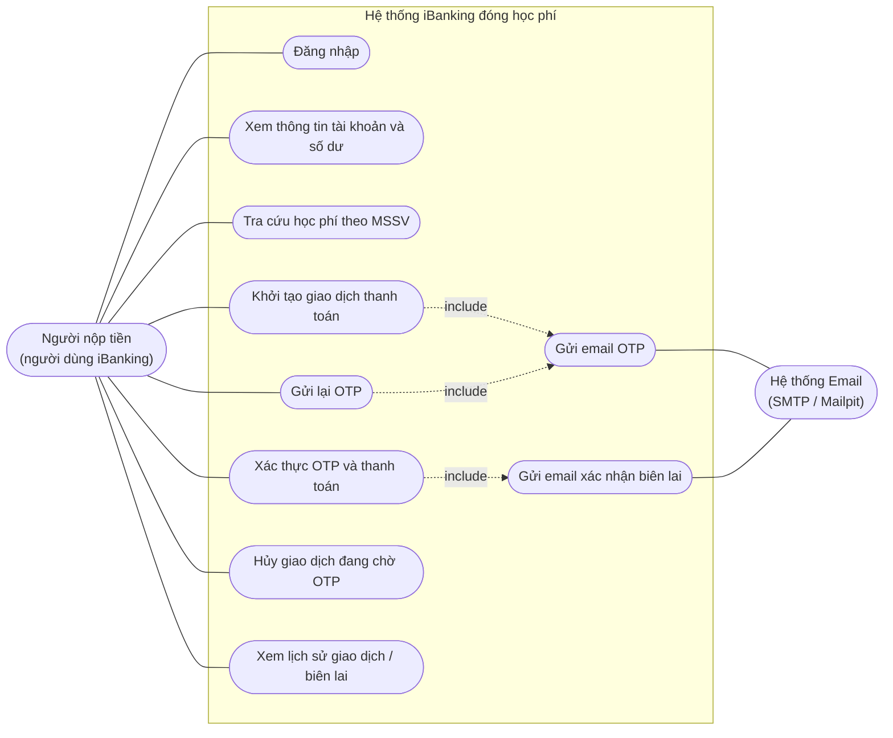
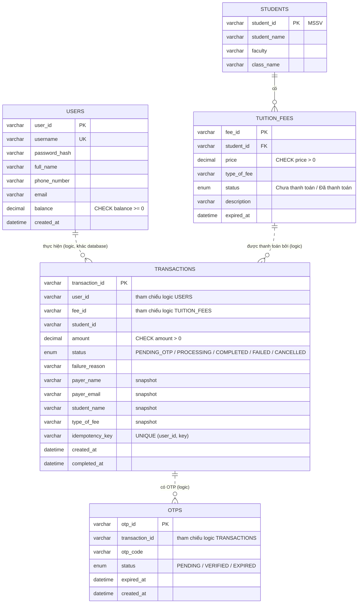
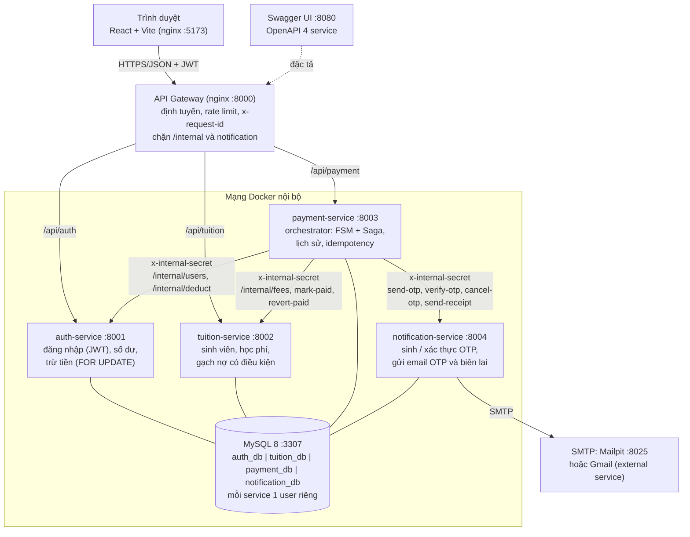
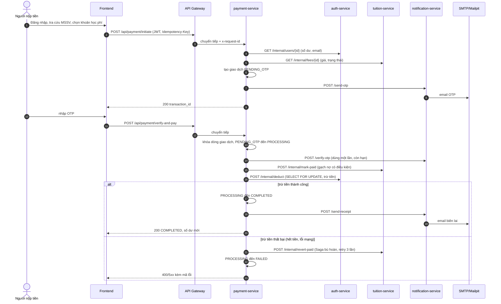
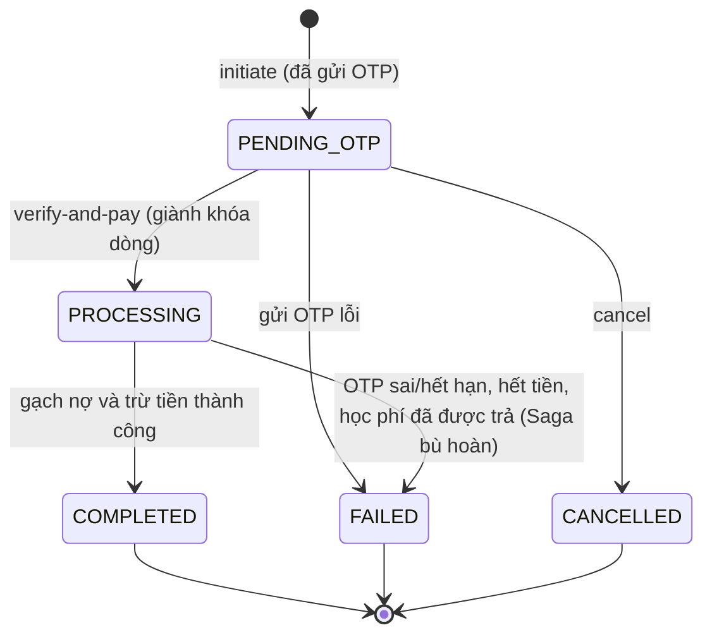

# Sơ đồ thiết kế (Mermaid)

Các sơ đồ dưới đây viết bằng Mermaid: xem trực tiếp trên GitHub / VS Code (extension *Markdown Preview Mermaid Support*),
hoặc dán code vào https://mermaid.live để **xuất PNG/SVG** đưa vào báo cáo. Gợi ý lưu ảnh vào `docs/use-case.png`,
`docs/erd.png`, `docs/architecture.png`.

## 1. Use Case Diagram

Actor: **Người nộp tiền** (người dùng iBanking) và **Hệ thống Email** (SMTP, external service). Notification Service gửi mail OTP / biên lai.

## 2. ERD (4 database, database-per-service)

Mỗi service sở hữu một database riêng trên cùng một MySQL server. **Không có khóa ngoại giữa các database**: các quan hệ nối
liền bên dưới là quan hệ logic, được đảm bảo ở tầng ứng dụng (payment gọi API của auth/tuition; bảng `transactions` lưu thêm
các cột snapshot để tra lịch sử mà không truy vấn chéo).

| Database | Service sở hữu | Bảng |
|---|---|---|
| `auth_db` | auth-service | `users` |
| `tuition_db` | tuition-service | `students`, `tuition_fees` |
| `payment_db` | payment-service | `transactions` |
| `notification_db` | notification-service | `otps` |

## 3. Microservices Architecture Diagram

**Lý do chọn kiến trúc**
- Tách theo nghiệp vụ: tài khoản/số dư, học phí, điều phối thanh toán, thông báo OTP. Mỗi service có database và quyền MySQL riêng (data ownership rõ ràng).
- `payment-service` là orchestrator duy nhất: chỉ nó gọi các service khác; frontend không bao giờ gọi API nội bộ.
- Giao tiếp đồng bộ REST/JSON (đơn giản, dễ demo, dễ test). Hệ quả: cần Saga bù hoàn khi trừ tiền thất bại sau khi đã gạch nợ.
- 1 MySQL server, 4 database: nhẹ cho demo trên một máy nhưng vẫn tách ranh giới dữ liệu bằng quyền truy cập.
- API Gateway là điểm vào duy nhất: gom URL, rate limit, truy vết, và không lộ API nội bộ ra ngoài.

## 4. Sequence: thanh toán học phí

## 5. Máy trạng thái giao dịch (FSM)

## 6. Hai tình huống concurrency và cách xử lý

| Tình huống | Rủi ro | Cơ chế |
|---|---|---|
| **A.** Một tài khoản thanh toán đồng thời nhiều khoản | Chi tiêu vượt số dư (double spending) | auth-service: `SELECT ... FOR UPDATE` khóa dòng `users`, kiểm tra `balance >= amount` và `UPDATE balance = balance - ?` trong cùng transaction; thêm `CHECK (balance >= 0)`. Giao dịch hết tiền bị từ chối, Saga hoàn tác gạch nợ |
| **B.** Nhiều tài khoản cùng thanh toán một khoản học phí | Một khoản học phí bị trả hai lần | tuition-service: `UPDATE ... SET status = 'Đã thanh toán' WHERE fee_id = ? AND status = 'Chưa thanh toán'`; chỉ request đầu có `affectedRows = 1`, các request sau nhận 409 `ALREADY_PAID` |
| Gửi trùng cùng một giao dịch | Xử lý hai lần | payment-service: `SELECT ... FOR UPDATE` trên dòng giao dịch và FSM; chỉ một request chuyển được `PENDING_OTP` sang `PROCESSING` |
| Retry `initiate` | Tạo giao dịch trùng | `Idempotency-Key` + `UNIQUE (user_id, idempotency_key)` |
